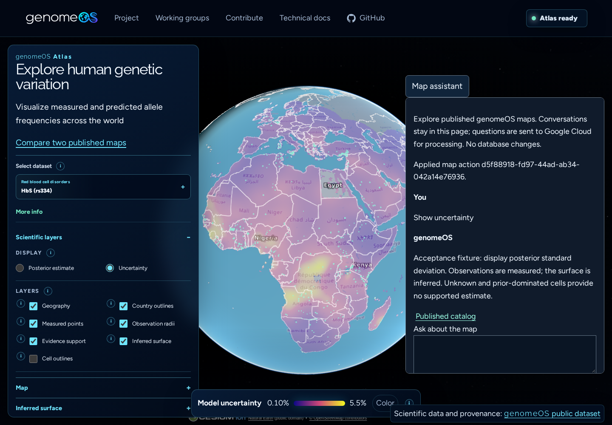

# Published-map assistant

The private map assistant implements the bounded subset of Atlas design §16 requested in
[#433](https://github.com/genomeOS/genomeOS/issues/433). It selects existing published views and
explains recorded metadata. It does not compute science, create artifacts, or modify any database.
The claim is that a natural-language request can select an exact, reproducible map without
confusing measurements with inferred surfaces. Acceptance evidence covers admission, versions,
mandatory masks, stale-action refusal, comparison denominators, URL restoration and database
immutability. Browser clients consume validated proposals; researchers consume cited records.

## Services and boundary

- Discover the 30 currently published maps.
- Display measured observations, inferred frequency or posterior standard deviation, with support
  always visible for assistant actions. Countries and place context are separate display layers.
- Focus the current viewport, the world, or West Africa. These named camera presets are display
  positions, never observation coordinates. Other regions currently require manual navigation.
- Explain the recorded measurement, uncertainty, limitations, versions and source terms.
- Prepare two independently labelled maps through the comparison route from PR #432.
- Undo a display change and share the complete versioned view URL.

Gemini selects a strict operation schema. The server then builds answers exclusively from the
admitted catalog and fixed scientific explanations; model-generated prose is never returned. There
is no general chat output, raw SQL, shell, arbitrary fetch, upload, ingestion or administrative tool.
Questions and the last four user questions are sent as untrusted user data, never privileged roles.
The model is instructed to refuse mixed or unrelated requests; even a hostile or mistaken selector
can only produce an admitted map operation or a recorded explanation. Domain classification is
probabilistic, while the resource and operation boundaries are enforced deterministically.

The publication allowlist is checked server-side against the exact variant, model/data versions,
dataset and pinned dataset revision. Candidate environmental sources are absent. Burden, personal
risk, region aggregates, correlation and pleiotropy are unavailable for every caller. This restricted
application does not expose the general P4 `/surface` or `/burden` endpoints to its model.
[#54](https://github.com/genomeOS/genomeOS/issues/54)'s broader class-based policy for those endpoints
remains separate work; this assistant must not grow general surface/burden tools before it lands.
Publication restrictions and CARE notices remain authoritative in the existing source and artifact
records. A catalog explanation is not a replacement for their full provenance.

## Local setup

Install the optional runtime dependencies:

```bash
uv pip install --python .venv/bin/python -e '.[chat]'
```

Use the repository gcloud wrapper to establish application-default credentials. Reuse the existing
project and billing account; no separate Gemini API key is required. The project needs the
`aiplatform.googleapis.com` API and the runtime identity needs permission to invoke Gemini.
The read-only check on 2026-10-11 found that API absent from the existing project's enabled
services and no repository-local ADC file. Live model qualification is therefore outstanding.

```bash
python scripts/gcloud_repo.py run auth application-default login
export GOOGLE_APPLICATION_CREDENTIALS="$PWD/.local/gcloud/genomeos/application_default_credentials.json"
export ATLAS_CHAT_GCP_PROJECT=YOUR_PROJECT_ID
export ATLAS_CHAT_SESSION_SECRET="$(python -c 'import secrets; print(secrets.token_urlsafe(32))')"
export ATLAS_CHAT_COOKIE_SECURE=false  # loopback development only
export ATLAS_CHAT_CATALOG_PATH="$PWD/website/public/data/atlas/catalog.json"
export ATLAS_CHAT_ALLOWLIST_PATH="$PWD/website/src/atlas/public-artifacts.json"
export ATLAS_CHAT_ORIGINS=http://localhost:4321
.venv/bin/uvicorn genomeos.chat.api:configured_app --factory --host 127.0.0.1 --port 8011
```

Run the website with `PUBLIC_ATLAS_CHAT_URL=http://localhost:8011` and use `http://localhost:4321`
for the website too. The panel stays disabled with an
explicit message when this setting is absent. `ATLAS_CHAT_MODEL` defaults to `gemini-3.8-flash`;
changing the provider model does not change admission or governance rules.

The assistant is a separate application: importing or starting it does not import SQLAlchemy,
open a database, or call `init_db`. `GET /v1/atlas/chat/catalog` serves bounded public metadata.
`POST /v1/atlas/chat` consumes a question and returns a read result/proposed action. HTTP method
does not define write permission: this POST has no persistence or mutation capability.

`GET /v1/atlas/chat/session` issues or reuses a signed anonymous browser cookie. Production uses
`__Host-genomeos-chat` with `Secure`, `HttpOnly`, `SameSite=Lax`, `Path=/` and no `Domain` attribute.
The browser owns this cookie; JavaScript receives only an opaque public session ID, a session-bound
CSRF proof and the expiry time. Every chat POST must include the cookie, the matching `X-CSRF-Token`
and an explicitly allowed Origin. Missing/expired cookies, forged IDs, another session's proof and
unapproved origins are rejected before the model call. Session-specific responses are `no-store`.

No session table or conversation store is created. IDs use 256 bits of cryptographic entropy and
expire after 24 hours. The signing key is an explicit server secret of at least 32 bytes; use a
cryptographically generated value, keep it out of git, and supply the same key to every replica.
Cookie verification works across replicas/restarts with that key. Rotating it invalidates old
credentials. The development-only non-Secure cookie is restricted to loopback origins and hosts.

Host the frontend and API on the same HTTPS site (for example `genome-os.org` and
`api.genome-os.org`), or proxy the API under the website's origin. A cross-site `run.app` URL is not
a supported cookie deployment with `SameSite=Lax`. Credentialed CORS uses exact origins; no wildcard
is accepted. The browser sends `credentials: include` for session bootstrap and chat requests.

## Receipts and privacy

Every action includes an ID, catalog revision and exact browser-state precondition. The browser
validates IDs, versions and available layers again, and waits for the displayed artifact and
renderer acknowledgement before showing an applied receipt. A comparison is a prepared link,
not a claim that both maps already rendered. Undo restores browser state; the URL reproduces the
view. Conversation text stays in component memory and is cleared on navigation or explicit clear.
Each browser profile has its own cookie; tabs in that profile share the identity but retain separate
transcripts and map state. New/expired identities clear the local conversation before a new chat.
Cancelled or cleared requests cannot append a late response. The model receives only that request's
question and optional browser-supplied prior questions, never a shared model conversation or session ID.
The backend keeps no conversations, scientific records or prompt logs. Google Cloud processes the
questions; provider retention must be assessed for the chosen project before deployment.

The application bounds input to 24 KB, messages to 2,000 characters, history to four questions,
one provider request per turn, output to 2,048 tokens, and a turn to 30 seconds. Process-local
limits are two concurrent requests, 20 requests/minute globally, six/minute per browser session and
12/minute per source address. Session limits do not use a client-selected ID; the server derives the
identity from the verified cookie. A shared address/global budget still bounds cookie-reset abuse.
These are preview limits, not distributed identity authentication. Anonymous sessions identify a
browser profile, not a person; a stolen cookie is a bearer credential. No endpoint lists or restores
other visitors' histories. A hosted release needs anonymous gateway rate limiting/bot protection,
billing quotas, a dedicated
service account with no database/storage-write permissions, read-only catalog mounts and tested
provider access. Never embed credentials in the static website. Do not deploy this preview as an
unrestricted public paid-model endpoint.

Responses are returned atomically after validation. The panel shows request progress and supports
cancellation; it does not stream unvalidated model text. Cancellation stops browser consumption;
an already accepted provider request may finish within the server deadline. No success receipt is
issued for a cancelled, stale, unavailable or unacknowledged action.

`Dockerfile.chat` packages this application separately with root-owned publication metadata and
an unprivileged runtime user. Set `ATLAS_CHAT_GCP_PROJECT`, provide `ATLAS_CHAT_SESSION_SECRET` as a
runtime secret and attach the dedicated runtime identity. Keep Secure cookies enabled in production.
The preview has not been deployed. The image build was attempted but this environment denied access
to `/var/run/docker.sock`; the image remains unverified.

## Verification

```bash
.venv/bin/python -m pytest tests/test_chat.py tests/test_chat_provider.py tests/test_chat_sessions.py
cd website
npm test -- --run tests/atlas-chat.test.ts tests/atlas-chat-rendering.test.ts tests/atlas-chat-session.test.ts
npm run check
```

For the real-browser isolation check, start the loopback-only fixture API in a separate terminal:

```bash
.venv/bin/uvicorn chat_session_app:create_test_app --factory --app-dir tests/fixtures \
  --host 127.0.0.1 --port 8017
```

Run the website dev server at `http://127.0.0.1:4335` with
`PUBLIC_ATLAS_CHAT_URL=http://127.0.0.1:8011`, then execute
`node website/scripts/verify-chat-sessions.mjs`. The test routes its own component requests to the
fixture API on port 8017 and uses an explicitly mocked renderer. Two actual browser profiles exercise
cookie isolation, separate question histories/transcripts/map replies, foreign-proof refusal,
same-profile tab identity reuse and cookie reset without affecting the other profile. The fixture
uses a public test-only signing key, makes no Google request and is not packaged in the runtime image.

Provider protocol tests use mocked HTTP responses and no credentials. They do not qualify the
actual project's quota, billing, model access or model-level intent accuracy. These must be
verified before deployment with the supported queries and malicious/mixed requests from #433.
Numerical trait analysis and pleiotropy still require independently qualified scientific inputs.

The review figure below uses the actual published HbS map with explicitly labelled deterministic
assistant responses. Regenerate it with `python scripts/plot_atlas_chat.py` against the local viewer;
the script also verifies renderer receipts, undo, stale refusal, comparison/share URLs and mobile fit.
It is a browser acceptance fixture, not evidence of a successful Gemini account call.


